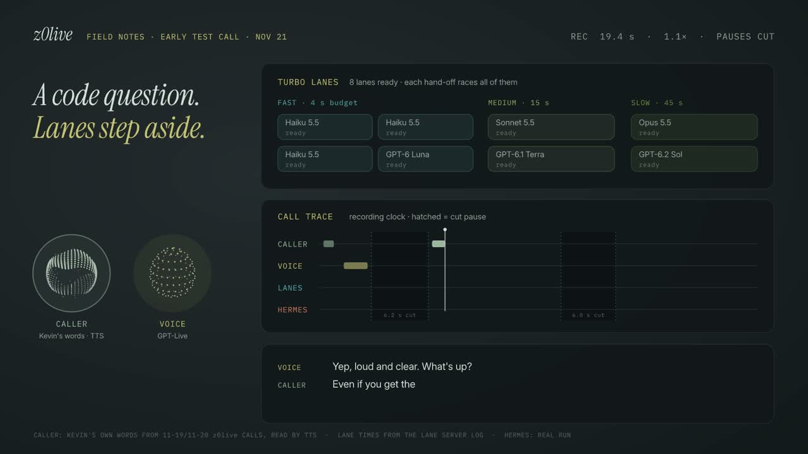
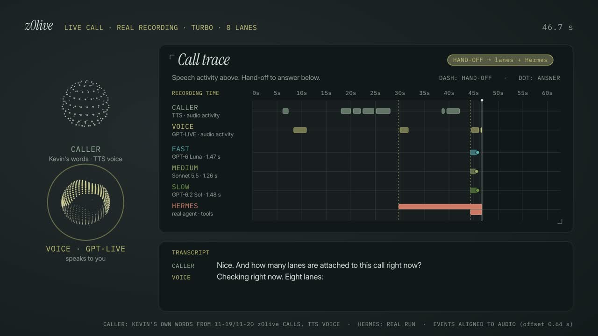

# z0live

z0live connects the Hermes mobile client to GPT-Live or Grok Voice. The Hermes plugin controls a separately installed z0live stack.

## Demos

Real recorded test calls (caller lines are Kevin's own words read by TTS; timings come from the call trace and the lane
server log). Click a poster to download the video from the [demos release](https://github.com/kvnloo/z0live/releases/tag/demos-2026-11-21).

| | |
|---|---|
| [](https://github.com/kvnloo/z0live/releases/download/demos-2026-11-21/z0live-field-notes-v4.mp4) | **Field notes: early troubleshooting and testing** (56 s, 1080p60, with music). One turbo-mode test call with the pauses cut and played at 1.1×: eight lanes racing a quick question and stepping aside for a code question, then the three bugs Hermes found in that call. |
| [](https://github.com/kvnloo/z0live/releases/download/demos-2026-11-21/z0live-live-demo-v3.mp4) | **Live call, real recording, turbo (8 lanes)** (62.6 s, 1080p60). The same call uncut on the recording clock: caller and voice audio activity, lane hand-offs and answers, and what Hermes found in the code afterwards. |

Film sources (Rust renderers, trace data and taste notes) are under [`docs/film/`](docs/film/).

## Install the Hermes plugin

The plugin is at the repo root on `main`. To install a specific revision, resolve the branch to a commit SHA first:

```sh
repo=https://github.com/kvnloo/z0live.git
ref=$(git ls-remote --exit-code "$repo" refs/heads/main | cut -f1)
hermes plugins install "$repo" --ref "$ref" --enable
```

| Surface | What it does |
|---|---|
| `z0live_status` | Voice engine for the next call, the second voice, lane models, lane server health, and the latest call's trace summary. Read only. |
| `z0live_configure` | Change the next call's engine or second voice, or change the adapter's fast/medium/slow model tiers. Use `reset_tiers: true` to restore the default tiers. |
| `z0live_lanes`, `/z0live-lanes` | Change the separate desktop helper-lane board in plain words: "gimme 2 fast lanes, 2 small, 2 large, one council". |
| `z0live_say` | Send a stock line such as "I'm still checking the details." to the active call linked to this Hermes session. |

The tools steer the z0live services; installing those is a separate step (`deploy/macos/install.sh`, see
[docs/STUDIO.md](docs/STUDIO.md)). Phone calls reach z0live through its own front door until Hermes core has a
voice-live provider seam ([RFC #77111](https://github.com/NousResearch/hermes-agent/issues/77111)).

The plugin looks for `lanes_file` or `traces_dir` as evidence of a configured stack. Point these settings at your deployment if you use nondefault paths. The lane-server status reports `unknown` on versions without `/health`.

To opt in to `z0live_say`, provide the same random `Z0LIVE_PROGRESS_TOKEN` secret to the voice adapter and the Hermes profile that handles the call. Set it in the Hermes profile's `.env` and the adapter's service environment. The adapter accepts requests only over loopback and requires one ready call linked to the requesting session. A successful tool response means the adapter accepted the line, not that the caller heard it.

### Privacy disclosure

- The plugin reads local configuration and summarizes local call traces. `z0live_status` returns event counts and call metadata, not transcript text. Hermes may send tool output to its configured agent model.
- The voice stack streams audio and context to OpenAI or xAI, depending on the call engine and guest settings. Model lanes can send context to their configured providers. The legacy Groq lane can send Hermes session excerpts when enabled. Do not run it on profiles with private history. The adapter's local traces can contain transcripts, delegation requests, and responses.
- `z0live_say` accepts only [stock lines](voice-adapter/progress_lines.json). The adapter sends the selected line to the call's voice provider. It does not send the local shared token, Hermes session ID, caller-supplied text, Telegram data, or chat history through this route.

## What this stack does beyond the plugin

The separately installed voice adapter and desktop broker have access beyond
the Hermes plugin's tools:

- The GPT-Live path reuses the host's existing login by reading
  `~/.codex/auth.json` without modifying it. It uses the login against
  `chatgpt.com` with `Codex Desktop` client headers.
- The stack reads every local Hermes profile's `state.db` in read-only mode to
  discover sessions and gather context. This is not limited to the profile
  that enabled the plugin.
- [`desktop/hermes_relay.py`](desktop/hermes_relay.py) attaches to Hermes sessions through
  the gateway. It can steer a running turn (`session.steer`) or submit a
  prompt (`prompt.submit`) for the next turn. The database access is read-only,
  but relaying prompts can change what a session does.

z0live is licensed under the GNU GPL v3 ([LICENSE](LICENSE)).

## Existing portable runtime work

The architecture in [RFC #1](https://github.com/kvnloo/z0live/issues/1) remains the project boundary:
`z0intelligence → VoicePlan → z0live ConversationActor → harness-native tools`.
z0intelligence owns model selection; z0live owns actor lifecycle, floor/barge behavior, replay and voice
fixtures; Hermes/OMP own execution and approvals. The substantial portable v0 implementation is in
[PR #6](https://github.com/kvnloo/z0live/pull/6), with Android/Tern/local voice additions in
[PR #7](https://github.com/kvnloo/z0live/pull/7). Neither branch is replaced or merged by the desktop broker.
The frozen certification wrapper is [z0evals PR #86](https://github.com/kvnloo/z0evals/pull/86).

## Desktop phone broker (this component)

`desktop/z0live_desktop/` hosts the phone broker. It connects ChatGPT Realtime and Hermes without choosing or ranking models:

```text
Android / web ── HTTPS tailnet /v1 ── z0live desktop broker
     │                                     │
     └──── direct WebRTC ── OpenAI          └── durable native runs ── Hermes (z0live)
                 audio                                          claude-opus-5-5
```

- Python stdlib only for the broker; OpenAI ephemeral secrets from existing host ChatGPT OAuth.
- Session-scoped schemas/persona; phone executes declared local tools and builtin dispatch.
- Authenticated events, history, inbox/SSE; per-session JSONL plus durable SQLite queues/cursors.
- Immediate owner feedback + compact active/end/idle summaries into one persistent Hermes session.
- Dedicated native Hermes API-only host: no messaging adapters, cron or kanban startup.
- Device pairing/revocation; 0600 verifier/key/database files under a 0700 data directory.

**Pinned multi-agent stack:** [docs/ARCHITECTURE.md](docs/ARCHITECTURE.md): Realtime → fast information liaison → persistent native meta agent → cheaper native workers. z0intelligence owns the VoicePlan; z0live owns floor/barge/replay. `ask_z0` is the preferred work entry point; existing tool names stay compatible. Summaries and old-session backlog are never spoken.

**API/Android integration:** [docs/API.md](docs/API.md).
**Deployment, recovery and verification:** [docs/OPERATIONS.md](docs/OPERATIONS.md).

```bash
# Host CLI (does not overwrite the future portable Python package)
Z0LIVE_BASE_URL="https://<your-host>:8791" ./bin/z0live pair phone-name
./bin/z0live devices
./bin/z0live serve

# Deterministic tests; no provider credentials/network needed
python3 -m unittest discover -s desktop/tests -v

# Opt-in real OpenAI WebRTC + native Hermes test; requires installed/running host services
npm ci --prefix desktop/tests
node desktop/tests/live_webrtc.mjs
```

The deployment intentionally leaves Garden Room unchanged; API.md describes a future adapter.
Live tests prove transport, GPT tool dispatch, native Hermes processing and reply delivery, **not**
physical Android microphone capture, speaker routing, background service policy or local phone actions.
