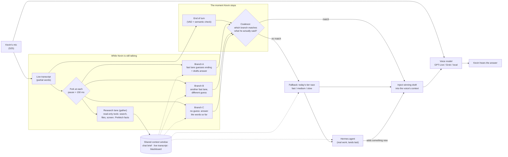

# Speculative branching: answer before the caller finishes

Status: proposal (2026-11-20). Not built. Owner idea: "run multiple simulations in parallel using a couple fast
lanes, then coalesce on the optimal path."

## In one paragraph

While Kevin is still talking, two or three fast lanes each guess how his sentence will end and draft an answer to
that guess. The drafts sit ready. The moment he stops, z0live compares what he actually said with each guess, picks
the branch that matches, and hands that draft to the voice, which speaks it at once instead of "Sure, I'll check".
If nothing matches, it falls back to today's path: the tier race plus Hermes.

## Diagram



## Timeline of one turn

```mermaid
sequenceDiagram
  participant K as Kevin
  participant Z as z0live
  participant F as Fast lanes (2-3)
  participant V as Voice
  K->>Z: "Can you find out how deep the Mari..."
  Z->>F: fork: guess endings, draft answers
  F-->>Z: draft A ("Mariana Trench": ~11 km)
  F-->>Z: draft B ("Marianas islands": ...)
  K->>Z: "...ana Trench is?" (stops)
  Z->>Z: match: A wins (B discarded)
  Z->>V: inject draft A
  V->>K: "About eleven kilometres, at Challenger Deep." (no filler)
  Z->>Z: tier race + Hermes continue; speak only if they add something
```

## The research lane (gather)

The tier lanes answer from model memory; the gather lane is the one helper with tools. In branching it is the
fact-fetching branch: it starts a read-only lookup as soon as the topic is clear mid-sentence, writes what it finds
to the shared context (blackboard) rather than to the voice, and serves as the check for risky kinds (math, live data,
gather), using the existing pre-speak gate (`lanes.py`: gate_kinds math/hard/gather, gate_ms 800). On a guess it
only reads: nothing that acts runs until the turn has ended and Hermes confirms. Lookups take seconds, so its result
usually lands after Kevin stops and is spoken only if it adds something.

Current state (inferred from code): with `Z0LIVE_TIERS=on` (the Studio install) the tier race replaces the older
instant/Fable/core-relay lanes, so the gather lane is likely not running on live calls today.

## Measured numbers this rests on (2026-11-19/20)

- Fast lanes answer 1.0-1.1 s after a hand-off (GPT-6 Luna, Haiku 5.5); local Gemma 4 E4B warm first token 0.04 s on
  the Studio; S25 cached lane prompt 0.18 s.
- Today the voice hands off ~1.5 s after Kevin stops, then says filler, then the answer (take 2: question ends 18.5 s,
  hand-off 20.1 s, lanes 21.4-22.3 s).
- Dessa takes its turn a median 0.43 s after the human stops.

## How it would be measured

Dessa replay (`voice-adapter/bench/dessa_run.sh`) for timing, plus two new numbers: filler rate (replies that open
with "I'll check"-type stalls) and branch hit rate (how often a speculative draft matched). Keep only if the turn gap
and filler rate drop and correctness (slm-v1-style grading of the spoken answer) does not.

## First-principles attack (poteto, 2026-11-20)

1. **Branching removes lane time, not the voice's own wait.** In take 2 the question ended at 18.5 s, GPT-Live handed
   off at 20.1 s (1.55 s: its end-of-turn decision plus the hand-off) and the lanes answered 1.3-2.2 s after that.
   Branching can only delete the second part. On GPT-Live, which owns its end-of-turn and exposes no control, the
   floor stays around 1.5 s: better than today, nowhere near Dessa's 0.43 s. The full win needs an engine where z0live
   decides when to speak (Grok if xAI honours it, or the local stack).
2. **The guessing may be unnecessary.** The lane config already starts lanes while Kevin talks. Most questions are
   answerable from the words before the last pause, so one branch ("answer what's been said so far", Branch C) may get
   nearly all the gain. Guessed endings only pay when the decisive word comes last ("…the Mariana *Trench*" vs
   "…*islands*"). Test before building: replay recorded turns cut at their last pause and count how often the
   answer to the cut version matches the answer to the full one.
3. **A wrong branch is worse than filler.** Answering a question Kevin didn't ask breaks trust more than "I'll
   check". The judge needs a confidence threshold and must default to the fallback.
4. **The judge must be nearly free.** It runs at end of turn, on the critical path: local string and embedding
   similarity in under 50 ms, never another model call.
5. **Injection timing is the known hazard.** Overnight run A8 measured GPT-Live starting to talk when context
   arrived at the wrong moment. Drafts must be injected only after end of turn, and the early-speech gate must stay.
6. **Cost and rate limits.** 2-3 branches at every pause is many calls per turn against subscription quotas. Fork
   only at pauses longer than ~250 ms with enough new words, and cancel branches as soon as they're contradicted.

Cheapest experiment first (offline, no live call): item 2's cut-at-last-pause replay on recorded turns, reporting
the hit rate for Branch C alone versus with guessed endings.

## Advisor critique

(Fable advisor review pending; added below when it lands.)
