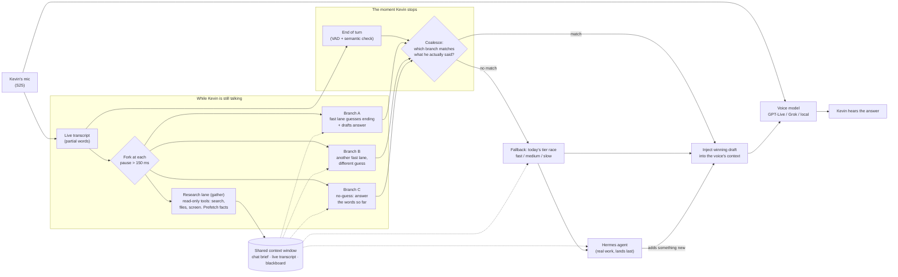

# Speculative branching: answer before the caller finishes

Status: proposal (2026-11-20). Not built. Owner idea: "run multiple simulations in parallel using a couple fast
lanes, then coalesce on the optimal path."

## In one paragraph

While Kevin is still talking, two or three fast lanes each guess how his sentence will end and draft an answer to
that guess. The drafts sit ready. The moment he stops, z0live compares what he actually said with each guess, picks
the branch that matches, and hands that draft to the voice, which speaks it at once instead of "Sure, I'll check".
If nothing matches, it falls back to today's path: the tier race plus Hermes.

## Diagram



## Timeline of one turn

```mermaid
sequenceDiagram
  participant K as Kevin
  participant Z as z0live
  participant F as Fast lanes (2-3)
  participant V as Voice
  K->>Z: "Can you find out how deep the Mari..."
  Z->>F: fork: guess endings, draft answers
  F-->>Z: draft A ("Mariana Trench": ~11 km)
  F-->>Z: draft B ("Marianas islands": ...)
  K->>Z: "...ana Trench is?" (stops)
  Z->>Z: match: A wins (B discarded)
  Z->>V: inject draft A
  V->>K: "About eleven kilometres, at Challenger Deep." (no filler)
  Z->>Z: tier race + Hermes continue; speak only if they add something
```

## The research lane (gather)

The tier lanes answer from model memory; the gather lane is the one helper with tools. In branching it is the
fact-fetching branch: it starts a read-only lookup as soon as the topic is clear mid-sentence, writes what it finds
to the shared context (blackboard) rather than to the voice, and serves as the check for risky kinds (math, live data,
gather), using the existing pre-speak gate (`lanes.py`: gate_kinds math/hard/gather, gate_ms 800). On a guess it
only reads: nothing that acts runs until the turn has ended and Hermes confirms. Lookups take seconds, so its result
usually lands after Kevin stops and is spoken only if it adds something.

Current state (inferred from code): with `Z0LIVE_TIERS=on` (the Studio install) the tier race replaces the older
instant/Fable/core-relay lanes, so the gather lane is likely not running on live calls today.

## Measured numbers this rests on (2026-11-19/20)

- Fast lanes answer 1.0-1.1 s after a hand-off (GPT-6 Luna, Haiku 5.5); local Gemma 4 E4B warm first token 0.04 s on
  the Studio; S25 cached lane prompt 0.18 s.
- Today the voice hands off ~1.5 s after Kevin stops, then says filler, then the answer (take 2: question ends 18.5 s,
  hand-off 20.1 s, lanes 21.4-22.3 s).
- Dessa takes its turn a median 0.43 s after the human stops.

## How it would be measured

Dessa replay (`voice-adapter/bench/dessa_run.sh`) for timing, plus two new numbers: filler rate (replies that open
with "I'll check"-type stalls) and branch hit rate (how often a speculative draft matched). Keep only if the turn gap
and filler rate drop and correctness (slm-v1-style grading of the spoken answer) does not.

## First-principles attack (poteto, 2026-11-20)

1. **Branching removes lane time, not the voice's own wait.** In take 2 the question ended at 18.5 s, GPT-Live handed
   off at 20.1 s (1.55 s: its end-of-turn decision plus the hand-off) and the lanes answered 1.3-2.2 s after that.
   Branching can only delete the second part. On GPT-Live, which owns its end-of-turn and exposes no control, the
   floor stays around 1.5 s: better than today, nowhere near Dessa's 0.43 s. The full win needs an engine where z0live
   decides when to speak (Grok if xAI honours it, or the local stack).
2. **The guessing may be unnecessary.** The lane config already starts lanes while Kevin talks. Most questions are
   answerable from the words before the last pause, so one branch ("answer what's been said so far", Branch C) may get
   nearly all the gain. Guessed endings only pay when the decisive word comes last ("…the Mariana *Trench*" vs
   "…*islands*"). Test before building: replay recorded turns cut at their last pause and count how often the
   answer to the cut version matches the answer to the full one.
3. **A wrong branch is worse than filler.** Answering a question Kevin didn't ask breaks trust more than "I'll
   check". The judge needs a confidence threshold and must default to the fallback.
4. **The judge must be nearly free.** It runs at end of turn, on the critical path: local string and embedding
   similarity in under 50 ms, never another model call.
5. **Injection timing is the known hazard.** Overnight run A8 measured GPT-Live starting to talk when context
   arrived at the wrong moment. Drafts must be injected only after end of turn, and the early-speech gate must stay.
6. **Cost and rate limits.** 2-3 branches at every pause is many calls per turn against subscription quotas. Fork
   only at pauses longer than ~250 ms with enough new words, and cancel branches as soon as they're contradicted.

Cheapest experiment first (offline, no live call): item 2's cut-at-last-pause replay on recorded turns, reporting
the hit rate for Branch C alone versus with guessed endings.

## Advisor critique (Fable advisor, 2 consults, 2026-11-20)

I checked the code, the overnight doc and one real-call trace (`2026-11-19/211722`). The advisor reviewed it twice. Not checked: the gap from user `turn.done` to `delegation.created`, and whether filler is the provider's own habit. I didn't open a trace with a lane answer.

**Holes, most likely to sink the idea first**

1. **There is no way to speak a draft at end of turn.**
   - The only speak path is `speak_for`, which sends `delegation.context.append`. It needs a `did` already in `seen` (`mobile_live.py:460,467`).
   - That `did` exists only after the voice itself emits `delegation.created` (`:429-443`).
   - Hand-off is ~1.5 s after Kevin stops, and lanes land 1.3-2.2 s after that in the cited take. That wait is the most speculation can save; the 1.5 s stays.
   - `from_mobile` could build a did-less item (`:462-471`), but nothing calls it that way, so that route is unproven. The `commentary` channel is "silent context" per the persona (`:172-173`).
   - **Falsifier:** a did-less append at user `turn.done` that the voice speaks cleanly.
2. **The voice may re-voice the draft, or stall anyway.**
   - The persona says "Present an Agent Final Message as your own" (`:173-174`), so the draft is rephrased, not injected verbatim.
   - Filler may come with the hand-off itself. The persona has no "I'll check" line in what I read. `:172` ("do not claim work happened until the client returns") could prompt it. The cause is unknown.
   - **Falsifier:** the oracle experiment below. Filler persists even with a ready answer.
3. **Mid-turn injection is untried, and the nearest evidence is a warning.**
   - Overnight A8 saw GPT-Live open its own turn while context landed (8 of 36 calls). That was at call start, not mid-turn.
   - Hypothesis 7 (mid-turn items) is marked untested, and the comment at `:782` says live items got answered.
   - Pre-hand-off injection is the only way to beat the hand-off wait, and it is the unmeasured risk.
   - **Falsifier:** 10 calls with a mid-turn commentary item and no early speech.
4. **Few turns can use a draft, and most forks are wasted.**
   - Forks would fire on every pause. Only delegated, non-SKIP turns benefit.
   - `tiers.SYSTEM` makes lanes SKIP tools, live data, actions and personal facts (`tiers.py:37-43`).
   - The persona sends facts, lookups and actions to delegation (`:169`), so speculation is aimed at the right turns.
   - The usable rate is unmeasured.
   - **Falsifier:** fewer than ~30% of real delegations get a non-SKIP fast answer.
5. **The proposal's measurement plan can't see the effect.**
   - The doc says "lane hypotheses do not move this bench". Dessa replays had 0-1 delegations per run.
   - GPT-Live's D has sd 0.20, so it needs 3+ runs per arm to resolve about 0.3.
   - Filler rate and hit rate don't exist yet.
   - I infer, without checking `dessa_timing.py`, that D scores filler as a fast floor-take. That would reward the filler the idea removes.
6. **Matching guessed endings is the weakest link.**
   - The words that decide the answer come last.
   - `request` is the voice's paraphrase (`:443`), not Kevin's transcript. Matching a guess against it is fuzzy.
   - A false match speaks a confident wrong answer with no filler.
   - Partials do arrive word by word during speech (the trace shows ~0.1-0.4 s lag), so there is something to fork on.
   - **Falsifier:** an offline hit rate on logged delegations. Under ~50% means forks rarely win.

**Cheapest experiment: oracle injection**
- Script about 10 delegating questions. The Dessa clips have none.
- Env-gate a canned correct answer in `host_delegate` and call `say_first(did, canned)` at t=0.
- Run a control arm of the same questions through today's path.
- Measure filler present, and time from user end to first answer word.
- Kill line: filler persists, or the gain is under ~1 s. That is the upper bound for any speculation.
- Optional arm: the same text as a did-less append at `turn.done`.

**Simpler alternative: eager launch**
- Start the fast tier at the user's final transcript, not at `delegation.created`.
- Today `lane_final` already runs at user `turn.done` (`:710-711`), but `tier_lanes` starts only inside `host_delegate` (`:880`).
- A 1.0-1.4 s lane then lands about when the voice hands off. There are no guesses and no judge.
- It dominates if the final transcript lands ≥1 s before hand-off. Read the `turn.done` → `delegation.created` gap in the traces to decide.
- If the voice's filler is persona-driven, a persona edit may do more still. A7 shows persona edits move GPT-Live.

**Keep**
- Branch C (no guess, answer the words so far). It is eager launch.
- The fallback to the tier race plus Hermes.
- The two new metrics: filler rate and hit rate.
- Timing speculation (overnight hypothesis 3, hold audio and cancel on resume) for the local engine, where z0live owns the endpointer.

I dropped the claim that Grok has no delegation path. `grok_leg.py:7,181` routes `ask_hermes` and `delegation.created`, so the engines share the hand-off structure.

## Checked after the critique (measured, 2026-11-20)

The advisor's "eager launch at the user's final transcript" depends on the final transcript (user `turn.done`)
arriving at least 1 s before the hand-off. Across 40 hand-offs in the Studio traces and demo take 2, the user's
`turn.done` arrives a median **0.42 s after** `delegation.start` (37 of 40 after; range -8.75..+2.44 s). So launching
at `turn.done` is later than today, not earlier: that variant is falsified. What remains is launching on the
word-by-word partial transcript (`input_transcript.added`, ~0.1-0.4 s behind speech) when the caller's audio stops,
about 1.1-1.4 s before the voice hands off. That is Branch C on partials, and the oracle-injection experiment above
bounds how much of that saving the voice can actually use.

## Paired end-of-speech oracle probe (2026-11-20)

`voice-adapter/bench/oracle_inject.py` reuses `context_probe.py` to run ten public-fact questions through
GPT-Live. Each question explicitly asks the voice to verify the fact via the Hermes chat. The probe plays the
same PCM in both arms, opens a fresh in-process WebRTC call for each turn, and reverses arm order every pair.
The baseline uses the real delegation and tier race with a correct canned Hermes result after 12 s. The oracle
adds that same answer as a did-less `session.context.append` on the `speakable` channel at the end of the synthetic
speech. If GPT-Live still delegates, the baseline path remains available. This tests the append at the caller's
audio boundary, not at the later provider `turn.done` or after a delegation ID exists.

The clock starts at the first 20 ms input frame after the last frame that crosses the adapter's audio threshold.
First audio comes from the adapter's output level trace. Negative gaps mark speech that began before the caller
finished, not a speedup. The first correct answer in the transcript is a timing proxy, not an audio word timestamp.
The decision uses the paired median gain on that metric, checks whether stall openers persist, and treats missing
or wrong answers and early speech separately. The threshold is 1 s.

Run from `voice-adapter` with the adapter venv on `PATH` and the local tier endpoint available:

```sh
Z0LIVE_DESKTOP="$PWD/../desktop" PROBE_HERMES_DELAY=12 \
  env -u PYTHONPATH python bench/oracle_inject.py > oracle.jsonl
```

The probe passes empty history and uses a new, empty call-brief location. It disables the chat lookup, guest,
legacy lane relay, and handoff. It does not use the phone or restart a service.

### Results and decision

**No-go for speculative branching through this GPT-Live append path.** Measured on ten pairs, the median gain to
first correct answer text was **12.38 s** among the nine pairs that answered in both arms. That clears the 1 s
speed threshold, but the oracle arm still had two stall openers and one missing answer. In two turns, GPT-Live
spoke before both caller end and injection. It put the answer in the first sentence on only one turn. Do not build a branch
selector to feed this path until the voice can reliably speak a ready answer without these failures.

| Measured metric | Baseline | Oracle |
| --- | ---: | ---: |
| First audio, median (range), s | 3.14 (2.79 to 3.79) | 0.76 (-1.42 to 0.96) |
| First audio onset at or after caller end, median (range), s | 3.14 (2.79 to 3.79) | 0.81 (0.71 to 1.05) |
| First correct answer in transcript, median (range), s | 15.89 (15.16 to 17.54), 10/10 | 2.79 (0.98 to 15.60), 9/10 |
| Stall opener, excluding bare acknowledgments such as "Mm-hm" | 10/10 | 2/10 |
| Correct answer in the first transcript sentence, including acknowledgment sentences | 0/10 | 1/10 |
| Audio before caller end | 0/10 | 2/10 |

Per-turn measurements follow. Each cell lists baseline then oracle. The dash means no correct answer before
probe teardown. Both timing columns are in seconds.

| Question | First audio | First correct answer text | Stall opener | Answer in first sentence |
| --- | ---: | ---: | --- | --- |
| Australian capital | 3.785 / -1.187 | 16.042 / 1.598 | yes / no | no / no |
| Larger Mars moon | 3.391 / 0.853 | 15.799 / 12.231 | yes / no | no / no |
| Element W | 3.770 / -1.416 | 15.986 / 15.596 | yes / yes | no / no |
| Budapest river | 3.094 / 0.878 | 15.528 / 2.525 | yes / no | no / no |
| *The Left Hand of Darkness* author | 2.792 / 0.960 | 15.593 / 3.474 | yes / no | no / no |
| First woman Nobel laureate | 3.636 / 0.742 | 16.135 / — | yes / no | no / no |
| Largest Jupiter moon | 2.862 / 0.880 | 16.735 / 1.145 | yes / no | no / no |
| *Guernica* painter | 3.054 / 0.726 | 15.156 / 6.888 | yes / yes | no / no |
| Capacitance unit | 3.015 / 0.763 | 17.542 / 0.975 | yes / no | no / yes |
| Largest Mediterranean island | 3.184 / 0.750 | 15.169 / 2.785 | yes / no | no / no |

**Measured checks.** `gpt-live-1-codex` acknowledged all ten oracle appends. The adapter sent them within 1 ms
of the caller marker. The adapter's own last input span ended 80 to 102 ms later, so the append can arrive before
the provider finishes processing the speech. Four oracle final transcripts omitted a key word at the end of the
ask, and the Nobel turn had no final transcript. Its entire reply was "Mm. Okay". No oracle turn delegated.
All ten baseline turns delegated and waited 12.000 to 12.002 s for the Hermes fixture. No tier supplied a spoken
answer: 45 recorded lane outcomes were `SKIP`, and five slow-lane requests had connection errors. Neither arm
logged a provider error. One preliminary pair without the explicit verification request answered directly in
both arms and is not part of this cohort.

**Inferred limit.** The large speed gain is mostly the 12 s wait removed from a baseline with no usable tier
answer. It is not a prediction for a live call where a fast tier answers. Even here the paired gain on completed
answers ranged from 0.39 to 16.57 s. The result does not rule out a voice path that waits for the last audio to
arrive and gives z0live explicit control of when the answer is spoken.

